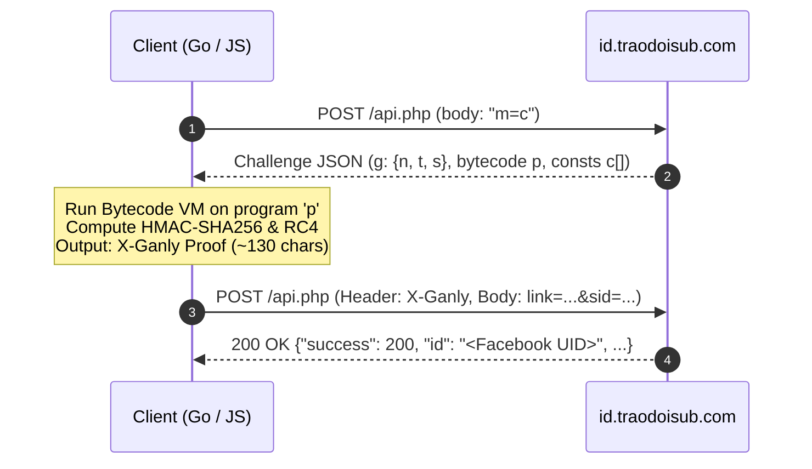

<div align="center">

# ⚡ Reverse Vault

**A curated collection of reverse engineering notes, custom bytecode VM deobfuscation, anti-bot challenge solvers, and web security research.**

[](https://opensource.org/licenses/MIT)
[](https://golang.org)
[](https://nodejs.org)
[](https://github.com/donyst/reverse-vault)

<br/>

> *"Deconstruct the opaque, understand the architecture, rebuild with elegance."*

</div>

---

## 🧭 Repository Overview

**Reverse Vault** serves as a modular sandbox documenting real-world security mechanisms, client-side challenge verifications, and reverse engineering case studies. Each project includes complete static/dynamic analysis notes, decompiled artifacts, and clean reference implementations without external bloatware.

---

## 📂 Vault Catalog

| Module | Target | Core Technology | Highlights | Status |
| :--- | :--- | :--- | :--- | :---: |
| [`id_traodoisub`](./id_traodoisub/) | `id.traodoisub.com` | Go, Node.js, WebCrack, Custom VM | Complete reverse engineering of dynamic 9-opcode bytecode VM & `X-Ganly` proof signer (~480ms turnaround) | `Completed` |

---

## 🔬 Featured Case Study: `id_traodoisub`

### 1. Challenge Architecture
The endpoint `id.traodoisub.com/api.php` enforces anti-bot protection via a lightweight, dynamic proof-of-work mechanism:
1. **Dynamic Bytecode Delivery**: The algorithm is **not statically baked** into the client code. Instead, the server delivers an ephemeral bytecode payload (`p`), array of constants (`c[]`), and cryptographic nonces (`g`).
2. **Custom Bytecode VM**: The client acts as a compact virtual machine with 9 native operations:
   - `0: base64UrlDecode` · `1: utf8Encode` · `2: sha256` · `3: hmacSha256`
   - `4: rc4` · `5: u48be` · `6: base64UrlEncode` · `7: nowMs` · `8: fingerprint`
3. **Proof Construction (`X-Ganly`)**: The VM combines client-side entropy, server nonces, browser fingerprinting (FNV-1a 32-bit), and timestamps into a 97-byte encrypted payload (`RC4` + `HMAC-SHA256`).



---

## 🚀 Quick Start

### Running with Go (Recommended)
Zero external dependencies. Powered entirely by Go's standard library (`crypto/*`, `encoding/*`, `net/http`).

```bash
cd id_traodoisub

# Run with sample Facebook target
go run main.go

# Or query a custom link
go run main.go "https://www.facebook.com/groups/1528487012172019/permalink/1684774203209965/"
```

### Running with Node.js
Pure JavaScript implementation without `npm install` requirements.

```bash
cd id_traodoisub

# CLI Execution
node signer.js "https://www.facebook.com/zuck"
```

```javascript
// Programmatic Usage
const { fetchFacebookId } = require('./id_traodoisub/signer');

const result = await fetchFacebookId("https://www.facebook.com/zuck");
console.log(result);
```

---

## 🛡️ Disclaimer

All materials, analysis, and code provided in this repository are strictly for educational purposes, security auditing, and academic research. The author does not condone unauthorized exploitation or service abuse. Use responsibly and in accordance with local regulations.

---

## 📄 License

This repository is licensed under the [MIT License](LICENSE).  
Copyright (c) 2026 [donyst](https://github.com/donyst).
