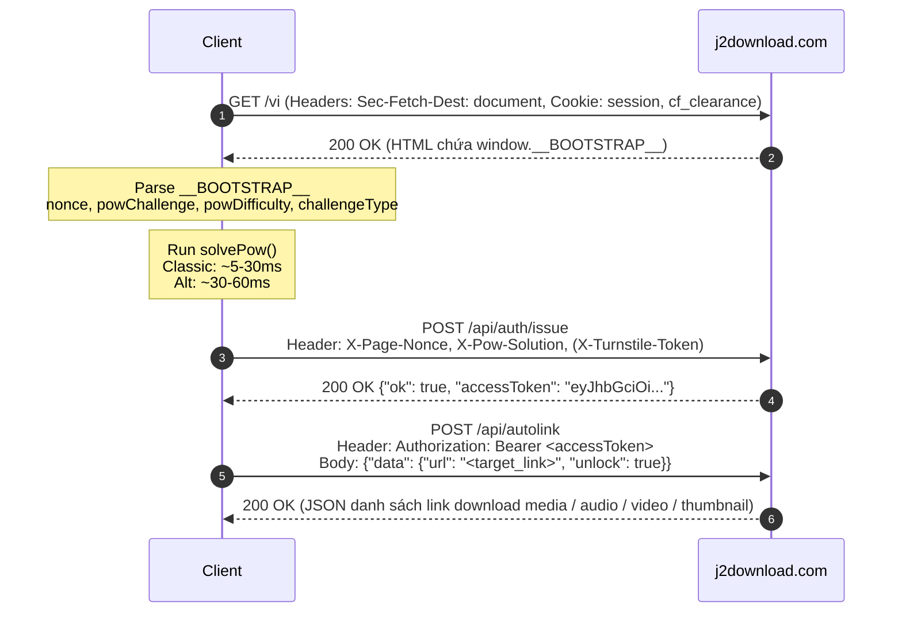

# Reverse Engineering: j2download.com — Security & Anti-Bot Analysis

**Target**: `https://j2download.com`  
**Endpoint Scope**:
- `POST /api/auth/issue` (Token exchange via PoW + Turnstile)
- `POST /api/autolink` (Media extraction & link resolver)

---

## 1. Tổng quan kiến trúc bảo mật

Hệ thống bảo vệ của `j2download.com` áp dụng mô hình bảo vệ 3 tầng (Multi-layered Protection):

1. **Lớp 1: Cloudflare Edge (WAF & Turnstile)**:
   - Cookie `cf_clearance` & `session`.
   - Cloudflare Turnstile widget (Sitekey: `0x4AAAAAABhlm-wzFjcykIge`).
   - Đòi hỏi cờ `X-Turnstile-Token` nếu phát hiện bot hoặc khi session kích hoạt `challenge_required`.

2. **Lớp 2: Proof-of-Work động (SHA-256 Nibble Zero Mining)**:
   - Được nhúng trực tiếp qua đối tượng SSR `window.__BOOTSTRAP__`:
     ```html
     <script>
       window.__BOOTSTRAP__ = {
         nonce: "3ecbede036d3081a3944dc9e0ec07313",
         powChallenge: "5e088ba75828933e8d41328ba277b682",
         challengeType: "classic", // hoặc "alt"
         powDifficulty: 3
       };
     </script>
     ```
   - Client phải chạy Web Worker giải bài toán tìm số nguyên `n` sao cho SHA-256 có $N$ số 0 (nibble = 4 bit) ở đầu hash.
   - Kết quả gửi qua header `X-Pow-Solution`.
   - Nonce gửi qua header `X-Page-Nonce`.

3. **Lớp 3: JWT Bearer Scoped Authentication (`accessToken`)**:
   - `POST /api/auth/issue` xác thực PoW solution + Page Nonce + Session.
   - Trả về JWT Access Token ngắn hạn (`exp - iat = 180s`, tức 3 phút).
   - Payload JWT chứa:
     ```json
     {
       "scope": "autolink",
       "sid": "<session_id>",
       "fp": "<sha256_fingerprint>",
       "iat": 1792263995,
       "exp": 1792264175
     }
     ```
   - Gọi `POST /api/autolink` kèm `Authorization: Bearer <accessToken>`.

---

## 2. Thuật toán Proof of Work (PoW)

Client thực thi giải PoW qua Web Worker chạy ngầm trong `app-B9ZSfaY9.js`:

### 2.1 Kiểm tra độ khó (Leading Zero Nibbles)
Một nibble tương đương 4 bit (nửa byte, 1 ký tự hex).
```javascript
function hasLeadingZeroNibbles(bytes, difficulty) {
  var fullBytes = (difficulty / 2) | 0;
  var hasHalfByte = (difficulty & 1) === 1;

  for (var i = 0; i < fullBytes; i++) {
    if (bytes[i] !== 0) return false;
  }
  if (hasHalfByte && (bytes[fullBytes] & 0xF0) !== 0) return false;
  return true;
}
```

### 2.2 Hai chế độ Challenge: `classic` và `alt`

#### A. Chế độ `classic`
Chuỗi đầu vào băm SHA-256:
```
input = "pow:" + powChallenge + ":" + n + ":" + nonce + ":" + powChallenge.length
```
Client lặp $n$ từ $0 \to 100,000,000$. Giá trị $n$ đầu tiên thỏa mãn độ khó được trả về làm nghiệm:
$$\text{X-Pow-Solution: } n$$

#### B. Chế độ `alt` (Double-Round PoW)
- **Vòng 1**:
  $$\text{input}_1 = \text{"pow:"} + \text{nonce} + \text{":"} + n_1 + \text{":"} + \text{powChallenge}$$
  Tìm $n_1$ thỏa mãn độ khó.
- **Phái sinh challenge vòng 2**:
  $$\text{secondChallenge} = \text{hex}(\text{SHA256}(\text{"pow:alt:"} + \text{powChallenge} + \text{":"} + \text{nonce} + \text{":"} + n_1))[0..16]$$
- **Vòng 2**:
  $$\text{input}_2 = \text{"pow:"} + \text{nonce} + \text{":"} + n_2 + \text{":"} + \text{secondChallenge}$$
  Tìm $n_2$ thỏa mãn độ khó.
- **Nghiệm tổng hợp**:
  $$\text{X-Pow-Solution: } n_1 + \text{"."} + n_2 \quad (\text{Ví dụ: } 18094.3089)$$

---

## 3. Bản giải mã API Flow



---

## 4. Danh sách Bundle Script đã capture
Toàn bộ 72 scripts của site đã được capture và lưu tại `.re/raw/`:
- `app-B9ZSfaY9.js`: Core logic, Auth manager, PoW worker builder, router.
- `Home-x3fYF7c2.js`: UI logic trang chủ, input handler.
- `vendor-vue-*.js`, `vendor-axios-*.js`: Thư viện lõi Vue 3 & Axios.
- `CardMulti-*.js`, `CardFFmpeg-*.js`, `CardSSE-*.js`: Bộ xử lý các loại media card.
