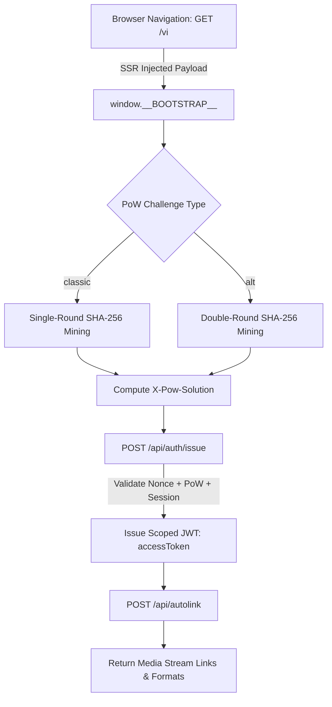
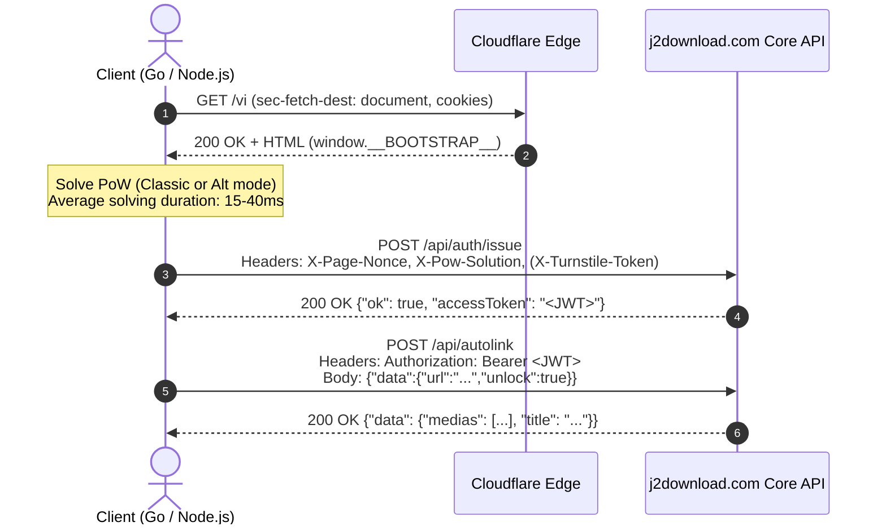

<div align="center">

# 🎬 J2Download — PoW Challenge Solver & Media Resolver

**Reverse engineering analysis, Web Worker PoW solver, and high-performance client implementation for `j2download.com`.**

[](https://golang.org)
[](https://nodejs.org)
[](../LICENSE)
[](https://j2download.com)

</div>

---

## 📑 Table of Contents

- [Overview](#-overview)
- [Multi-Tier Protection Architecture](#-multi-tier-protection-architecture)
- [Proof-of-Work (PoW) Mechanics](#-proof-of-work-pow-mechanics)
  - [Zero-Nibbles Verification](#1-zero-nibbles-verification)
  - [Classic Mode](#2-classic-mode)
  - [Alt Mode (Double-Round Mining)](#3-alt-mode-double-round-mining)
- [API Flow & Sequence](#-api-flow--sequence)
- [Repository Structure](#-repository-structure)
- [Quick Start](#-quick-start)
  - [Go Client (Zero Dependencies)](#running-with-go)
  - [Node.js Client](#running-with-nodejs)
- [Programmatic API](#-programmatic-api)

---

## 🔎 Overview

`j2download.com` is a high-traffic media downloading service (supporting Facebook, TikTok, Instagram, YouTube, etc.). To protect its infrastructure from automated scraping and API abuse, the service employs a three-tier defense matrix:

1. **Cloudflare WAF & Edge Challenge** (`cf_clearance`, Turnstile sitekey `0x4AAAAAABhlm-wzFjcykIge`).
2. **SSR Dynamic Proof-of-Work (PoW)** embedded in `window.__BOOTSTRAP__`.
3. **Short-Lived Scoped JWT Authentication** (`/api/auth/issue` $\to$ `/api/autolink`).

This module documents the deobfuscated algorithms extracted from client bundle chunks (`app-B9ZSfaY9.js`, `Home-x3fYF7c2.js`) and provides zero-dependency implementations in **Go** and **Node.js**.

---

## 🛡️ Multi-Tier Protection Architecture



---

## ⚙️ Proof-of-Work (PoW) Mechanics

Every document navigation (`GET /vi`) renders an inline bootstrap JSON:

```html
<script>
  window.__BOOTSTRAP__ = {
    nonce: "4097416028936cc2f9dfe1630bec099b",
    powChallenge: "38d36caea738824ec31e16ef69a5df7e",
    challengeType: "classic", // or "alt"
    powDifficulty: 3          // number of 0-nibbles required
  };
</script>
```

### 1. Zero-Nibbles Verification

A **nibble** represents a 4-bit block (one hexadecimal character). A difficulty of `3` requires the first 12 bits (1.5 bytes) of the SHA-256 digest to be zero (`0x000...`).

```go
func hasLeadingZeroNibbles(digest []byte, difficulty int) bool {
    fullBytes := difficulty / 2
    hasHalfByte := (difficulty & 1) == 1

    for i := 0; i < fullBytes; i++ {
        if digest[i] != 0 {
            return false
        }
    }
    if hasHalfByte && (digest[fullBytes]&0xF0) != 0 {
        return false
    }
    return true
}
```

### 2. Classic Mode

The hash preimage is formatted as:
$$\text{input} = \text{"pow:"} + \text{powChallenge} + \text{":"} + n + \text{":"} + \text{nonce} + \text{":"} + \text{len}(\text{powChallenge})$$

The miner increments $n$ starting from $0$. The first $n$ satisfying the zero-nibble criteria is the solution:
$$\text{X-Pow-Solution} = n \quad (\text{e.g., } 10567)$$

### 3. Alt Mode (Double-Round Mining)

When `challengeType == "alt"`, the challenge uses chained double-round mining:

1. **Round 1**:
   $$\text{input}_1 = \text{"pow:"} + \text{nonce} + \text{":"} + n_1 + \text{":"} + \text{powChallenge}$$
   Find $n_1$ satisfying `powDifficulty`.

2. **Chained Derivation**:
   $$\text{secondChallenge} = \text{hex}(\text{SHA256}(\text{"pow:alt:"} + \text{powChallenge} + \text{":"} + \text{nonce} + \text{":"} + n_1))[0..16]$$

3. **Round 2**:
   $$\text{input}_2 = \text{"pow:"} + \text{nonce} + \text{":"} + n_2 + \text{":"} + \text{secondChallenge}$$
   Find $n_2$ satisfying `powDifficulty`.

4. **Composite Solution**:
   $$\text{X-Pow-Solution} = n_1 + \text{"."} + n_2 \quad (\text{e.g., } 18094.3089)$$

---

## 🔄 API Flow & Sequence



---

## 📁 Repository Structure

```
j2download/
├── .re/                      # Reverse engineering sandbox
│   ├── raw/                  # 76 full raw frontend JS assets & chunks
│   │   ├── app-B9ZSfaY9.js   # Main application core & PoW worker
│   │   ├── Home-x3fYF7c2.js  # Main page state machine & resolver
│   │   ├── worker-BAtsrYyp.js# Web Worker bundle
│   │   └── ...               # Complete vendor & i18n locales
│   └── NOTES.md              # Technical notes & deep-dive disassembly
├── engine.js                 # ⚡ Autonomous Turnstile & PoW Resolver (Zero npm deps)
├── client.js                 # Complete Node.js HTTP client
├── pow_solver.js             # Standalone JavaScript PoW solver module
├── pow_solver.go             # High-performance Go PoW solver module
├── main.go                   # Go CLI client & autolink resolver
└── README.md                 # Project documentation
```

---

## 🚀 Quick Start

### 🌐 Pure HTTP Client (Auto-Generated Cookies & Zero Browser)

**100% headless, lightweight standard library requests** (Go `net/http` & Node.js `https`). No Chromium, no Puppeteer, no CDP, and **no preset cookies required**!

#### 🔑 Automatic Cookie Generation Mechanics:
1. **Initial Handshake**: The client sends a clean `GET /vi` with standard browser navigation headers (`sec-fetch-dest: document`, `sec-fetch-mode: navigate`).
2. **SSR Auto-Minting**: The `j2download.com` SSR engine automatically responds with `Set-Cookie: session=<hash>; Max-Age=599` and injects `window.__BOOTSTRAP__`.
3. **Pure PoW Verification**: Because the session is fresh, the server grants access via `POST /api/auth/issue` based purely on the solved Proof-of-Work challenge—**Turnstile challenge is completely bypassed**!

#### Go CLI:
```bash
cd j2download

# Runs out of the box with 0 browser, 0 preset cookies, 0 external dependencies:
go run main.go pow_solver.go "https://www.facebook.com/groups/1528487012172019/permalink/1685137529840299/"
```

#### Node.js CLI:
```bash
cd j2download

# Pure Node.js https client (zero npm dependencies, zero preset cookies):
node client.js "https://www.facebook.com/groups/1528487012172019/permalink/1685137529840299/"
```

---

### ⚡ Autonomous Turnstile Engine (`engine.js`)

Optional fallback utility for environments requiring explicit interactive Turnstile token synthesis via Chrome CDP WebSocket:

```bash
cd j2download

node engine.js "https://www.facebook.com/groups/1528487012172019/permalink/1685137529840299/"
```

---

## 💻 Programmatic API

### Node.js Example

```javascript
const { J2DownloadClient } = require('./client');

async function main() {
  const cookie = "session=...; cf_clearance=...";
  const client = new J2DownloadClient(cookie);

  // 1. Fetch fresh bootstrap
  const bootstrap = await client.fetchBootstrap();
  console.log('Bootstrap Nonce:', bootstrap.nonce);

  // 2. Solve PoW and issue Bearer JWT
  const token = await client.issueToken(bootstrap);
  console.log('JWT Token:', token);

  // 3. Resolve media URL
  const result = await client.resolveAutolink("https://www.facebook.com/groups/1528487012172019/permalink/1685137529840299/");
  console.log('Result:', result);
}

main().catch(console.error);
```

---

## ⚖️ License

Distributed under the [MIT License](../LICENSE). Part of [Reverse Vault](https://github.com/donyst/reverse-vault).
